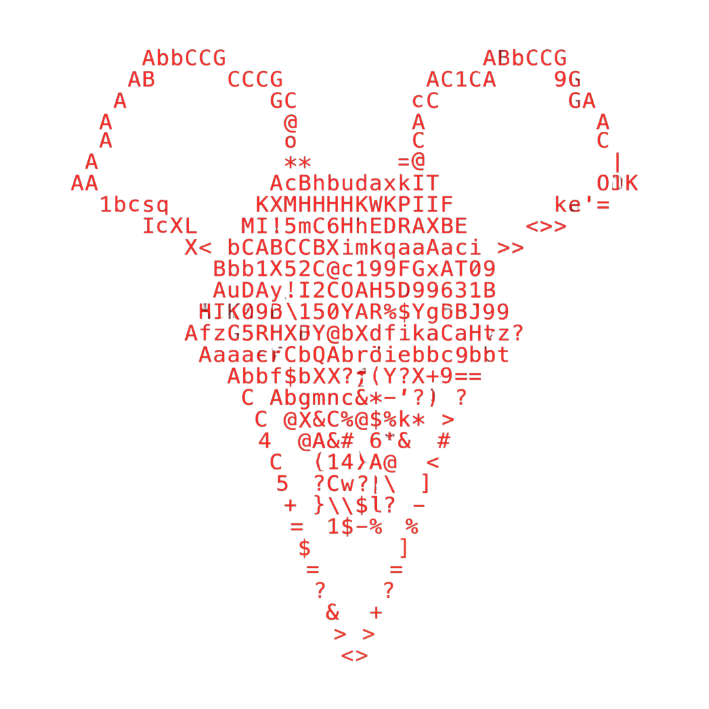

<div align="center">




<sub><code>daks-2k25@github:~$ whoami --ascii</code></sub>

```text
root@daks-2k25:~$ whoami

████████╗██╗  ██╗██╗ █████╗  ██████╗  ██████╗
╚══██╔══╝██║  ██║██║██╔══██╗██╔════╝ ██╔═══██╗
   ██║   ███████║██║███████║██║  ███╗██║   ██║
   ██║   ██╔══██║██║██╔══██║██║   ██║██║   ██║
   ██║   ██║  ██║██║██║  ██║╚██████╔╝╚██████╔╝
   ╚═╝   ╚═╝  ╚═╝╚═╝╚═╝  ╚═╝ ╚═════╝  ╚═════╝

███████╗██████╗ ███████╗██╗████████╗ █████╗ ███████╗
██╔════╝██╔══██╗██╔════╝██║╚══██╔══╝██╔══██╗██╔════╝
█████╗  ██████╔╝█████╗  ██║   ██║   ███████║███████╗
██╔══╝  ██╔══██╗██╔══╝  ██║   ██║   ██╔══██║╚════██║
██║     ██║  ██║███████╗██║   ██║   ██║  ██║███████║
╚═╝     ╚═╝  ╚═╝╚══════╝╚═╝   ╚═╝   ╚═╝  ╚═╝╚══════╝
```


<a href="https://github.com/daks-2k25">
  
</a>

<br/>


</div>


## `$ cat about.md`

```bash
daks-2k25@github:~$ cat about.md

Estudante de Análise e Desenvolvimento de Sistemas (ADS) — 2º semestre de 4.
Estagiando como desenvolvedor júnior, aprendendo, evoluindo e construindo coisas reais.

> full-stack: Next.js / React no front, Node.js / NestJS no back
> gosto de tirar ideia do papel e colocar em produção
```


## `$ ls tech-stack/`

<div align="center">

**Languages**


**Frontend**


**Backend & Database**


**Automação & Ferramentas**


</div>


## `$ cat featured-project.md`

<div align="center">

### 🔴 LeadMiner

**Descubra e organize oportunidades comerciais capturadas do Google Maps.**

</div>

Sistema full-stack de prospecção de leads: busca e captura informações comerciais do Google Maps por termo, cidade, bairro e categoria, organiza os resultados em um painel e permite exportar tudo.

- 🔍 Busca de leads com filtros por termo, cidade, bairro e categoria
- 📊 Painel com total de leads, leads com telefone e leads com site
- 🕘 Histórico de buscas e buscas salvas
- 📤 Exportação de resultados (Excel)
- 🚧 Em desenvolvimento: relatórios e configurações avançadas

**Stack:** Next.js · React · TailwindCSS &nbsp;|&nbsp; NestJS · Prisma · PostgreSQL · JWT &nbsp;|&nbsp; Playwright (engine de scraping)

<div align="center">

<a href="https://github.com/daks-2k25/MinerLeads-V1"></a>
<a href="https://miner-leads-v1.vercel.app"></a>

</div>


## `$ ls -la projects/`

<table width="100%">
<tr>
<td width="50%" valign="top">

**🔴 Vittace**

Landing page institucional para clínica de odontologia e estética facial.

  

[`repo`](https://github.com/daks-2k25/Vittace) · [`demo`](https://vittace.vercel.app)

</td>
<td width="50%" valign="top">

**🔴 sistema-caixa-eletronico-python**

Simulação de caixa eletrônico via terminal — projeto do 1º período de ADS para praticar lógica de programação.


[`repo`](https://github.com/daks-2k25/sistema-caixa-eletronico-python)

</td>
</tr>
<tr>
<td width="50%" valign="top">

**🔴 calculadora-medias-python**

Calculadora de médias com tratamento de erros.


[`repo`](https://github.com/daks-2k25/calculadora-medias-python)

</td>
<td width="50%" valign="top">

**🟡 Gerenciador-agenda-contatos** <sub>*(em desenvolvimento)*</sub>

Gerenciador de agenda de contatos.


[`repo`](https://github.com/daks-2k25/Gerenciador-agenda-contatos)

</td>
</tr>
</table>

<details>
<summary>📦 ver todos os repositórios</summary>
<br/>

<a href="https://github.com/daks-2k25?tab=repositories"></a>

</details>


## `$ ./github-stats.sh`

<div align="center">


<sub><code>daks-2k25@github:~$ cat contributions.map</code></sub>


<sub><code>daks-2k25@github:~$ ./defend_commits.sh</code></sub>



</div>


## `$ cat contact.txt`

<div align="center">

<a href="https://github.com/daks-2k25"></a>
<a href="mailto:thiagofreitasdelima9@gmail.com"></a>

</div>


<div align="center">


</div>
